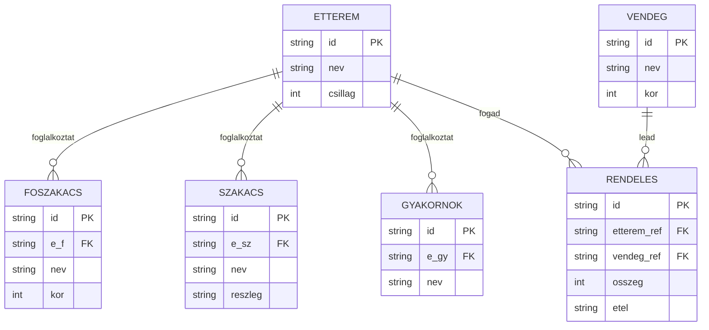

# 1. konzultacio

`LRY9XW`

## Fajlok

- `LRY9XW_orarend.xml`
- `LRY9XW_xmltohtml.html`
- `LRY9XW.orarendXDM.drawio`
- `LRY9XW.orarendER.drawio`
- `LRY9XW_konferencia.xml`
- `XDMLRY9XW.drawio`
- `LRY9XW_XML.xml`
- `LRY9XW_vendeglatas_chatgpt_prompt.txt`

## Vendeglatas ER

